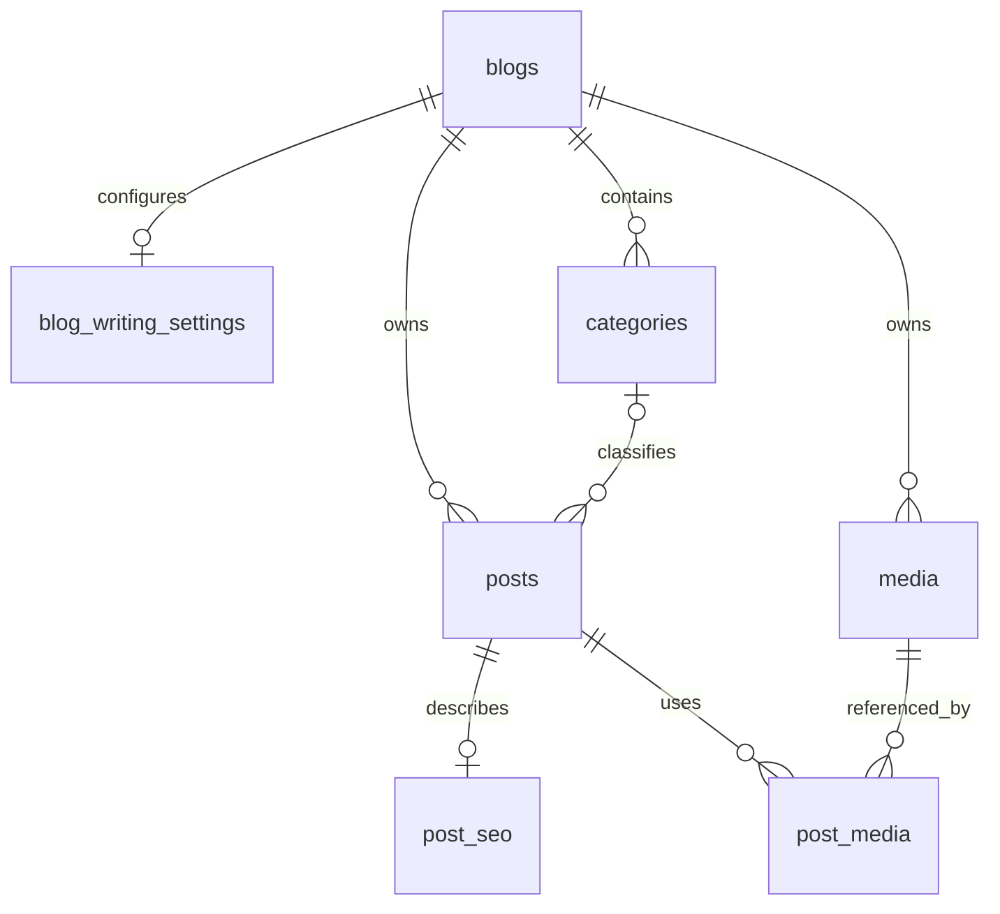

# 데이터 모델 v1 — 블로그 기반

기준일: 2026-11-03. 구현 SQL: [0001_blog_schema.sql](../packages/database/migrations/0001_blog_schema.sql).

현재 범위는 블로그 업무 테이블 7개와 로컬 적용이다. 실제 화면의 저장/조회, 원격 마이그레이션, R2 파일 업로드, AI 작업 테이블은 별도 단계에서 진행한다.

## 관계



## 공통 규칙

- SQL은 snake_case, 향후 TypeScript 계약은 camelCase로 매핑한다.
- ID는 애플리케이션에서 생성하는 UUID 문자열이다. 테스트는 별도 예약 ID를 사용한다.
- 날짜는 UTC Unix 밀리초 INTEGER. DB 기본값은 초 단위 시간을 밀리초로 변환하며, 서비스에서는 Date.now()를 바인딩한다.
- STRICT 테이블, 외래 키, CHECK, UNIQUE 제약을 사용한다. DB 제약은 접근 제어를 대신하지 않으며 모든 쿼리에 blog_id 조건을 적용한다.
- 도메인은 프로토콜/경로/포트가 없는 소문자 호스트명, 미연결은 NULL이다. 사용자 입력 URL 파싱·IDN 변환·DNS 연결 확인은 앱에서 처리한다.
- slug는 앱에서 NFC·소문자·하이픈 형태로 정규화한다. SQL NOCASE 고유성은 ASCII 대소문자를 구분하지 않는다. 전체 Unicode 동등성은 앱 검증이 필요하다.
- updated_at은 자동 트리거로 갱신하지 않는다. 서비스에서 관련 변경값과 함께 명시적으로 갱신한다.

## 1. blogs

| 필드 | 타입 | 의미 |
| --- | --- | --- |
| id | TEXT PK | 블로그 ID |
| name | TEXT | 이름, 1~80자 |
| description | TEXT | 소개, 최대 300자 |
| language | TEXT | ko / en / ja |
| domain | TEXT NULL UNIQUE | 공개 호스트명, 미연결 허용 |
| created_at / updated_at | INTEGER | 작성/수정 시각 |

다중 블로그의 소유 경계이다. 글·카테고리·이미지가 있으면 블로그 삭제를 제한한다.

## 2. blog_writing_settings

| 필드 | 타입 | 의미 |
| --- | --- | --- |
| blog_id | TEXT PK/FK | 블로그당 최대 1행 |
| topic / audience / tone | TEXT | 주제·대상 독자·말투, 각각 최대 300자 |
| rules / avoid_expressions | TEXT | 작성 규칙·피해야 할 표현, 각각 최대 3,000자 |
| updated_at | INTEGER | 설정 수정 시각 |

설정이 없을 때 앱 기본값을 사용할 수 있다. 설정 저장 시 upsert하고, 실제 AI 요청에는 당시 설정을 작업 스냅샷으로 보관하도록 이후 작업 모델에서 확장한다. 블로그 삭제 시 설정도 제거한다.

## 3. categories

| 필드 | 타입 | 의미 |
| --- | --- | --- |
| id / blog_id | TEXT | 카테고리 ID·소유 블로그 |
| name / slug | TEXT | 1~40자 이름·1~100자 주소명 |
| description | TEXT | 최대 300자 |
| sort_order | INTEGER | 1~999, 같으면 이름순 |
| created_at / updated_at | INTEGER | 작성/수정 시각 |

(blog_id, name), (blog_id, slug)가 고유하다. '미분류' 행은 만들지 않는다. 글이 있으면 외래 키가 삭제를 차단하며, 모든 초안·발행·비공개 글을 먼저 다른 분류 또는 NULL로 옮긴 뒤 삭제한다.

## 4. posts

| 필드 | 타입 | 의미 |
| --- | --- | --- |
| id / blog_id | TEXT | 게시글 ID·소유 블로그 |
| category_id | TEXT NULL | 분류, NULL은 미분류 |
| title / slug | TEXT | 1~200자 제목·1~120자 주소명 |
| content_json | TEXT | Tiptap JSON, 기본값은 빈 문단 |
| excerpt | TEXT | 목록용 요약, 최대 500자 |
| status | TEXT | draft / published / private, 기본 draft |
| origin | TEXT | manual / ai, 기본 manual |
| revision | INTEGER | 변경 충돌·검증 버전 연결용, 기본 1 |
| created_at / updated_at | INTEGER | 최초 작성·저장 수정 시각 |
| content_updated_at | INTEGER | 마지막 의미 있는 콘텐츠 수정 시각 |
| published_at | INTEGER NULL | 최초 발행 시각 |

- (blog_id, slug)가 고유하며, (blog_id, category_id) 복합 외래 키로 다른 블로그 분류 연결을 차단한다.
- JSON 문법·doc 루트·content 배열은 DB가 확인한다. 허용 노드/마크, 안전한 URL, 본문 크기 등 상세 검증은 공통 Zod 계약과 서버 저장 계층에서 구현한다.
- published는 published_at이 있어야 한다. private/draft로 바꿔도 최초 발행일은 보존할 수 있다.
- 공개 쿼리는 반드시 status='published'를 적용한다. 초안 미리보기는 관리자 인증으로 보호한다.
- 앱은 WHERE id=? AND blog_id=? AND revision=? 조건으로 수정하고 revision을 증가시켜 충돌을 감지할 예정이다. 컬럼만 추가된 상태이며 현재 UI에는 적용하지 않았다.
- updated_at과 content_updated_at을 구분한다. 관리 정보만 바뀌면 콘텐츠 수정일을 올리지 않고, 본문/제목/대표 이미지 등 공개 콘텐츠가 바뀌면 갱신한다.
- 발행 후 slug 변경은 초기 UI에서 잠근다. 리다이렉트·발행본/편집본 버전 분리와 QA 승인 무효화는 발행/AI 구현 단계에서 후속 설계·마이그레이션으로 연결한다.

## 5. post_seo

| 필드 | 타입 | 의미 |
| --- | --- | --- |
| post_id | TEXT PK | 글당 최대 1행 |
| blog_id | TEXT | 소유 블로그 검증 |
| meta_title / title_source | TEXT NULL / TEXT | 최대 100자 검색 제목·auto/ai/manual |
| description / description_source | TEXT NULL / TEXT | 최대 300자 설명·auto/ai/manual |
| updated_at | INTEGER | SEO 수정 시각 |

- 제목과 설명의 생성 방식을 각각 기록한다. 직접 수정한 값은 재생성 시 자동 덮어쓰지 않는다.
- NULL + auto는 제목/본문 기반 기본값을 사용한다는 의미이다. manual/ai는 비어 있지 않은 값이 필요하다.
- Canonical·OG·JSON-LD는 도메인·slug·게시글·대표 이미지에서 조합한다. 임의 canonical 값은 저장하지 않는다.
- 글과 SEO 저장은 D1 batch로 함께 반영할 예정이다. 글 삭제 시 SEO 행도 삭제한다.

## 6. media

| 필드 | 타입 | 의미 |
| --- | --- | --- |
| id / blog_id | TEXT | 파일 ID·소유 블로그 |
| r2_key | TEXT UNIQUE | R2 객체 키, URL이 아님 |
| original_name | TEXT | 원본 파일명, 최대 255자 |
| mime_type | TEXT | JPEG / PNG / WebP / GIF / AVIF |
| size_bytes | INTEGER | 0보다 큰 실제 파일 크기 |
| width / height | INTEGER NULL | 파악한 경우 0보다 큰 이미지 크기 |
| created_at | INTEGER | 등록 시각 |

파일 자체는 R2 연결 단계에서 저장한다. 검증/업로드가 성공한 객체만 media에 등록하는 방식으로 구현할 예정이다. SVG는 현 파일 업로드 허용 형식에 포함하지 않으며, 공개 블로그의 기존 로컬 SVG 일러스트는 이 테이블 대상이 아니다.

## 7. post_media

| 필드 | 타입 | 의미 |
| --- | --- | --- |
| post_id / media_id / blog_id | TEXT | 게시글·파일·소유 블로그 |
| usage | TEXT | cover / inline |
| alt | TEXT | 글에서 사용하는 대체 텍스트, 1~500자 |
| position | INTEGER | 이미지의 0부터 시작하는 위치, cover는 0 |

- 대표 이미지 최대 1개. 본문 이미지는 위치별로 연결하며 한 파일을 여러 위치/글에서 재사용할 수 있다.
- 글·파일이 같은 블로그여야 한다. 대표 이미지·본문 사용처에 따라 alt를 별도로 보관한다.
- 글 삭제는 사용 관계만 삭제한다. 다른 글에서 재사용할 수 있으므로 R2 파일이나 media 행을 자동 삭제하지 않는다.
- 사용 중인 media 삭제는 제한한다. 실제 R2 삭제와 미사용 파일 정리는 업로드 단계에서 구현한다.
- R2 연결 시 Tiptap 이미지와 media ID/위치의 동기화 계약을 추가한다. 본문 편집 후 재정렬도 서비스에서 처리한다.

## 조회 인덱스

- 카테고리: blog_id, sort_order, name
- 관리자 글 목록: blog_id, updated_at DESC, id DESC
- 공개 글 목록: blog_id, status, published_at DESC, id DESC
- 카테고리별 공개 목록: blog_id, category_id, status, published_at DESC, id DESC
- 파일 사용처: blog_id, media_id

제목 검색은 초기에는 바인딩된 LIKE 검색으로 구현할 수 있다. FTS·방문 통계·인기 글은 조회 패턴이 확정되면 추가한다.

## 적용과 검증

```powershell
pnpm db:test:schema
pnpm db:migrate:local
pnpm db:test:local
```

스키마 테스트는 인메모리 SQLite에서 제약 조건을 확인한다. 로컬 D1 테스트는 예약 ID의 검증 행을 삽입·조회한 뒤 제거한다. 원격 DB에는 이 마이그레이션과 테스트 데이터를 적용하지 않았다.

운영에 적용된 마이그레이션은 수정하지 않고 다음 번호의 SQL로 변경한다. OAuth 토큰이나 R2 비밀값은 스키마·시드에 넣지 않는다.

후속 테이블: agent_jobs, agent_job_steps, sources, 검수/발행 버전, publish_schedules. AI·예약 기능의 요구사항을 확정한 뒤 추가한다.
